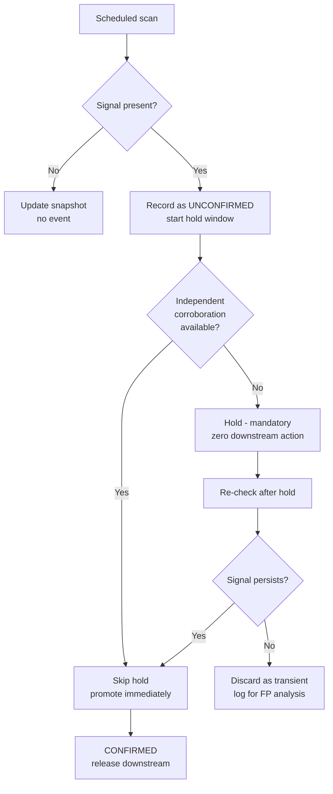

# Change Detection Pipelines for External Systems

Engineering notes from building a production pipeline that detects state changes across tens of thousands of entities in a large third-party directory, a system that provides no change notifications, no event stream, and no guarantee that absence means what it looks like.

The hard part of this class of problem is not scraping. It's **deciding when a signal is real**, and building a data model that lets you answer that question after the fact.

Design patterns and reasoning only. No client name, no source code, no data, and no disclosure of the specific detection signal used in the original system. That mechanism is the client's, and it stays theirs.

**Deep dives:** [Snapshot schema](docs/01-snapshot-schema.md) · [Confirmation protocols](docs/02-confirmation-protocols.md)

---

## Contents

1. [Problem class](#1-problem-class)
2. [Why naive polling fails](#2-why-naive-polling-fails)
3. [Two-stage confirmation](#3-two-stage-confirmation)
4. [Append-only snapshots](#4-append-only-snapshots)
5. [Corroboration as a confidence layer](#5-corroboration-as-a-confidence-layer)
6. [Authoritative-source verification](#6-authoritative-source-verification)
7. [Cadence and capacity](#7-cadence-and-capacity)
8. [Identity and deduplication](#8-identity-and-deduplication)
9. [Spreadsheet to database](#9-the-spreadsheet-to-database-migration)
10. [Failure modes](#10-failure-modes)
11. [What I'd do differently](#11-what-id-do-differently)

---

## 1. Problem class

You are tracking N entities that exist in a system you don't control. You need to know when one of them changes state: appears, disappears, gets restricted, gets modified. The platform offers:

- No webhooks
- No change feed
- No API guarantee of consistency between reads
- No distinction, in its responses, between *"this no longer exists"* and *"this request didn't work"*

That last one is the whole problem.

This shape recurs far beyond the original domain: monitoring competitor pricing, tracking regulatory register entries, watching certificate or licence status, detecting takedowns, following inventory across marketplaces. In each case the naive implementation of poll, diff, alert produces a system that cries wolf until nobody trusts it.

### The economics that drive the design

Not all errors cost the same, and the ratio determines the architecture.

| Error | Cost |
|---|---|
| **False positive**, signal fires but nothing actually changed | Downstream action taken wrongly. Wasted outreach, damaged credibility, and critically, erosion of trust in the whole system |
| **False negative**, real change missed this cycle | Detected on the next cycle. Cost is latency, not correctness |

**False positives are expensive and compounding; false negatives are cheap and self-correcting.** A missed change surfaces next run. A false alarm that reaches a human is unrecoverable, and after a handful of them, operators start ignoring the alerts, which silently converts your entire system into an expensive no-op.

Every design decision below follows from that asymmetry. When in doubt, **wait and re-check** rather than fire.

---

## 2. Why naive polling fails

```python
# The version everyone writes first
for entity in tracked:
    current = fetch(entity.id)
    if current is None and entity.last_seen is not None:
        emit_change_event(entity)      # <- wrong
        entity.last_seen = None
```

Absence in a single read has at least six causes, and only one of them is the event you care about:

1. The entity genuinely changed state ✅
2. Rate limiting returned an empty result rather than an error
3. Transient platform-side failure
4. Regional/edge inconsistency, where the platform's own replicas disagree
5. Your request was fingerprinted and served degraded results
6. The identifier changed while the entity persisted (rename, merge, re-key)

Cause 6 is the nastiest. The entity is fine, but your key no longer resolves. A naive differ reports a change with total confidence, and no amount of retrying the same key will correct it.

Treating a single negative read as truth means your event stream is mostly noise. Measured against manual verification, single-read detection produced a false positive rate high enough to make the output unusable for any automated downstream action.

---

## 3. Two-stage confirmation

The core pattern: **a signal is a hypothesis, not a fact.** Promotion from hypothesis to confirmed event requires a second independent observation, separated in time.



### The hold window

A mandatory delay between first signal and confirmation, during which **no downstream action occurs at all**. Not a provisional notification, not a "possible change" flag on a dashboard someone might act on. Nothing leaves the system.

This is the single highest-value component in the pipeline. It converts the dominant false-positive class, transient failures, into discarded noise, at the cost of delaying real events by one hold period.

Given the cost asymmetry in §1, that trade is overwhelmingly correct.

**Sizing the hold:** long enough to outlast transient failures, short enough that the event is still actionable. Derive it from measurement, not intuition. Instrument the distribution of *how long unconfirmed signals persist before resolving*, and set the hold above the bulk of the transient population. Transients typically resolve in minutes to hours; real changes persist indefinitely. The distribution is usually strongly bimodal, which makes the threshold easy to pick once you can see it.

### The corroboration bypass

If an *independent* source already confirms the change, the hold is redundant. You have two observations, just not two of your own. Promote immediately.

This matters because the hold is pure latency cost. Any path that safely skips it improves responsiveness with no loss of precision. The requirement is genuine independence: a second read of the same endpoint through the same path is not corroboration, it's the same observation twice.

### Why *not* just retry immediately

Immediate retry catches only the narrowest transient class. Rate limiting, fingerprinting-induced degradation and replica inconsistency all persist across a fast retry. The second read fails the same way as the first, and you've built confidence in a wrong answer. Time separation is doing the work, not repetition.

Full detail: [docs/02-confirmation-protocols.md](docs/02-confirmation-protocols.md)

---

## 4. Append-only snapshots

The schema decision that made everything else tractable: **observations are never overwritten.**

```
entities                    -- current known state, one row per entity
presence_snapshots          -- append-only. one row per entity per scan
state_change_events         -- append-only. confirmed events only
```

Every scan writes a new snapshot row. Nothing is updated in place. `entities` is a materialised view of latest state, rebuildable from snapshots at any time.

### Why this matters more than it looks

**You can reconstruct history.** "Was this entity present on the 14th?" is answerable. With mutate-in-place, that question is unanswerable forever, because the data is simply gone.

**You can tune thresholds retrospectively.** Changing the hold window on a mutating schema means waiting weeks to see the effect. On append-only snapshots you replay history against the new threshold and measure immediately. This makes the difference between tuning by evidence and tuning by argument.

**You can measure your own false positive rate.** Every unconfirmed signal that later resolved is a recorded false positive. Without append-only history you have no idea how noisy your detector is, which means you can't tell whether changes improved it.

**Backfill is safe.** Re-processing a period is idempotent, since you only write more snapshot rows. Nothing is destroyed by getting it wrong.

**Debugging becomes possible.** When someone asks why an event fired, the answer is a query, not a reconstruction.

### The cost

Storage grows linearly with `entities × scan_frequency`. This is almost always the right trade, because storage is cheap and history is irreplaceable. Manage it with partitioning by scan date and a retention policy that rolls old snapshots into per-entity summaries rather than deleting outright.

Full schema: [docs/01-snapshot-schema.md](docs/01-snapshot-schema.md)

---

## 5. Corroboration as a confidence layer

A signal from one source is a signal. The same signal from independent sources is evidence.

Where an entity appears in multiple directories, cross-referencing raises confidence before anything is handed downstream:

```
primary signal (source A)
    + corroborating check (sources B, C, D)
    = confidence tier
```

### Design rules

**Corroboration adds confidence; it never overrides.** Cross-source checks are an additional layer on top of primary confirmation, not a replacement for it. Different platforms have different data lifecycles, and an entity can legitimately be absent from one and present on another for reasons unrelated to the event you're detecting. Treating a secondary source as authoritative introduces a *new* false positive class rather than reducing the existing one.

**Sources are not equally reliable, and the weighting must be explicit.** Record which source produced which observation, and keep per-source accuracy statistics. A source that has been wrong repeatedly should count for less, and you can only know that if you've been recording attribution from the start.

**Absence of corroboration is not disconfirmation.** Many entities exist on only one platform. "Not found on B" for an entity that was never on B carries no information. Distinguish *checked-and-absent*, *checked-and-present*, and *not-applicable* explicitly in the schema, because collapsing them into a boolean loses the distinction permanently.

**Corroboration must be genuinely independent.** If sources B and C both derive from the same upstream aggregator, they are one source wearing two hats, and agreement between them means nothing. Verify provenance before treating sources as independent.

---

## 6. Authoritative-source verification

Detection tells you an entity's state changed on a platform. It doesn't tell you the entity is real, current, or worth acting on.

A separate enrichment stage validates entities against **authoritative registries**, meaning official databases that are the system of record for whether an organisation legitimately exists and is currently in good standing. Public registries of this kind exist across many sectors: professional licensing bodies, national provider databases, transport and financial regulators, corporate registration authorities.

### Why this is a separate stage

Detection and verification have completely different characteristics:

| | Detection | Verification |
|---|---|---|
| Cadence | High, every cycle | Low, monthly or quarterly |
| Volatility | Changes constantly | Changes rarely |
| Cost per check | Low | High, varies by registry |
| Failure impact | Miss an event | Stale validity flag |

Running them on the same schedule means either wasting enormous effort re-verifying stable facts, or under-sampling the volatile signal. Splitting them lets each run at its natural frequency.

### Cadence by volatility

Registry re-check intervals should follow how quickly each registry's data actually changes. Some sectors have high entity turnover and warrant frequent re-checks; others are stable and quarterly is ample. Setting a single global interval means over-polling stable registries and under-polling volatile ones simultaneously.

### Normalisation is the real work

Every registry has its own schema, its own name formatting, its own identifier scheme, and its own idea of what an address is. The engineering effort is overwhelmingly in **normalisation and entity resolution**, not in fetching. Budget accordingly: the fetch is a day, the matching is a fortnight.

---

## 7. Cadence and capacity

Re-check frequency is a **capacity decision constrained by rate limits**, not a product preference. It's tempting to specify cadence by business desire ("check high-value entities every 48 hours"), then discover the request budget doesn't support it and quietly drift to something else.

### The failure this creates

Documented cadence and actual cadence diverge. Downstream logic assumes the documented figure. Nobody notices until someone asks why a change took five days to surface and the answer contradicts the specification.

### Rules that prevented it

**Cadence is derived, not declared.** Compute it: `available_request_budget / entity_count`, adjusted per tier. If the result doesn't meet the business requirement, that's a capacity conversation, not a documentation exercise.

**Actual cadence is measured and monitored.** Track observed inter-scan intervals per entity. Alert when they drift from target. The gap between intended and actual is where trust quietly dies.

**Deviations get resolved explicitly, in writing.** When operational cadence diverges from spec, that's a decision requiring a call: is this a temporary capacity constraint or a permanent change? Leaving it ambiguous means two people hold different models of how the system behaves, and both are making plans on that basis.

### Tiering

Not all entities warrant equal attention. Tiering by value lets the request budget concentrate where it matters. The tier definition is a business input; the *implementation* rule is that tier assignment must be **visible in the snapshot record**, so you can later answer "was this checked as often as we thought?"

---

## 8. Identity and deduplication

The hardest correctness problem here isn't detection. It's knowing that the thing you're looking at today is the thing you looked at last week.

### Why external identifiers aren't enough

Platform identifiers seem like stable primary keys and are not. They get re-issued, merged, split and rotated. An entity can persist while its identifier changes, which a naive pipeline reports as *simultaneous disappearance and appearance of two unrelated entities.*

### The approach

**Composite identity.** Maintain multiple identifier types per entity plus normalised attribute fingerprints (name, location, contact details). Identity is a *match across several signals*, not equality on one field.

**Never hard-delete on identity change.** When an identifier stops resolving, that's a hypothesis about identity, not a fact about existence, so it goes through the same confirmation discipline as any other signal.

**Record identity resolution decisions.** When the system decides two observations are the same entity, log the decision and its basis. Entity resolution is probabilistic and gets things wrong; unlogged decisions are unauditable and unfixable.

**Deduplicate at write, not read.** Reconciling duplicates at query time means every consumer reimplements the logic, and they will not agree. One canonical resolution at ingestion.

---

## 9. The spreadsheet-to-database migration

The system began, as many do, in spreadsheets: rows appended by scripts, formula-driven derived columns, humans editing alongside automation. It ended as a relational database with no spreadsheet in the live path.

### Why spreadsheets stop working

**No append-only guarantee.** A human can overwrite an automated cell, and the prior value is gone. Everything in §4 becomes impossible.

**Formulas are computation without version control.** A derived column encodes business logic that nobody reviews, that changes without a commit, and that silently breaks when a row shape changes.

**Concurrency is undefined.** Automation writing while a human edits produces outcomes with no defined semantics.

**Performance degrades non-linearly.** Volatile formulas over tens of thousands of rows make the document unusable at exactly the point the dataset becomes valuable.

**No referential integrity.** Nothing prevents a row referencing an entity that doesn't exist.

### Why they're still the right *starting* point

Spreadsheets front-load speed and back-load cost. Early on, the schema is unknown, requirements change weekly, and stakeholders need to *see* data to tell you what they actually want. A spreadsheet gets you to that conversation in a day.

The mistake is not starting there. It's staying there past the point where the schema has stabilised.

### Migration rules that worked

**Full cutover, not dual-run.** Running both in parallel guarantees divergence and doubles maintenance. Pick a date; make the database authoritative; retire the sheet from the live path entirely.

**Spreadsheets remain fine for analysis.** Exporting a query result for one-off human analysis is good. The rule is: never in the *live path*, never as a system of record.

**Zero manual steps between detection and storage.** Any human step in the automated path is where reliability dies. It's unmonitored, undocumented, and dependent on one person remembering. If a step needs doing, automate it or explicitly own it as a scheduled task with alerting.

**Migrate the schema, not the layout.** The temptation is to recreate tabs as tables. Tab structure reflects spreadsheet ergonomics, not the data model. Design the relational schema from the domain and map onto it.

---

## 10. Failure modes

| Failure | Symptom | Mitigation |
|---|---|---|
| Rate limit returns empty rather than error | Mass simultaneous "changes" | Absolute + relative caps on events per cycle; halt and alert on breach |
| Platform layout change | Extraction silently returns null | Canary entities with known-stable state, checked every cycle |
| Identifier rotation | Entity reported gone and new one appeared | Composite identity matching (§8) |
| Silent partial scan | Subset never checked, assumed unchanged | Explicit per-entity scan receipts; alert on coverage gap |
| Clock/timezone drift | Hold windows computed wrongly | Store UTC everywhere; compute holds in absolute time |
| Backfill double-count | Same event emitted twice | Idempotency key on `(entity, signal_type, detected_window)` |
| Corroboration source outage | Confidence tiers silently drop | Distinguish *unavailable* from *disconfirming* in the schema |

### The cap on events per cycle is worth emphasising

If your detector suddenly reports that 40% of tracked entities changed state simultaneously, the overwhelmingly likely explanation is that **your pipeline broke**, not that the world did.

A hard cap, both absolute and as a proportion of the tracked set, that halts the pipeline and alerts rather than emitting, is the cheapest catastrophic-failure protection available. It costs an hour to build. Without it, a single upstream change can push thousands of false events downstream before anyone notices, and unwinding that is far more expensive than the delay.

---

## 11. What I'd do differently

**Build the append-only schema first.** It was introduced after the mutating version, and the migration cost real effort while permanently losing the earlier history. Nothing else is fully debuggable without it.

**Instrument false positive rate from day one.** For a long stretch the detector's precision was a matter of opinion. It should have been a dashboard from the first week, because you cannot improve what you haven't measured, and you can't argue about it productively either.

**Derive cadence from capacity at design time.** Specifying it as a business requirement and discovering the constraint later produced a documentation/reality gap that took a while to fully close.

**Separate detection from enrichment earlier.** They were entangled initially, which meant slow registry checks throttled the fast detection loop. Splitting them was straightforward and should have been the starting shape.

**Treat identity resolution as a first-class subsystem.** It was handled incrementally as problems appeared. It deserved a design.

---

## Pattern summary

The transferable core, independent of domain:

1. **Signals are hypotheses.** Require independent confirmation before acting.
2. **Time separation beats retry.** Transients survive immediate retries; they don't survive hold windows.
3. **Append-only, always.** History is the only thing that makes tuning, auditing and debugging possible.
4. **Corroborate, don't override.** Secondary sources raise confidence; they don't replace primary confirmation.
5. **Split by volatility.** Fast-changing and slow-changing data want different cadences and different pipelines.
6. **Derive cadence from capacity.** Declared cadence that exceeds the request budget is fiction.
7. **Identity is composite.** External identifiers are not stable primary keys.
8. **Cap the blast radius.** Mass simultaneous events mean you broke, not the world.

---

## Stack

n8n · Supabase / PostgreSQL · scheduled scraping and API integration · append-only event modelling · multi-source corroboration · entity resolution · rate-limit-aware capacity planning · Python

---

*Design patterns and engineering notes only, published with the client's written permission. Contains no source code, credentials, business data, client information, commercial terms, or disclosure of the specific detection signal or scoring methodology used in the original system.*
